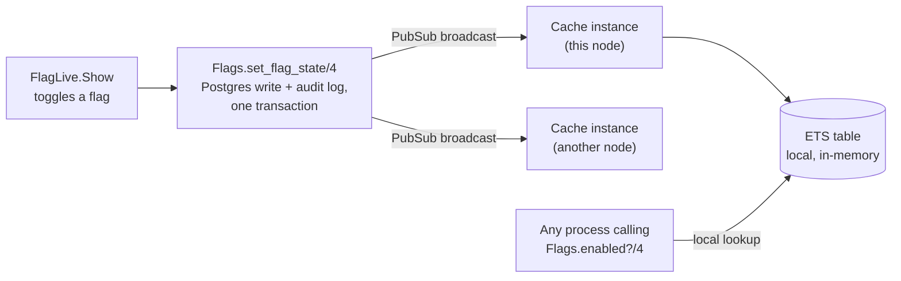

# Beacon

A feature-flag and rollout service. Create a flag, turn it on per
environment, and roll it out by percentage — the same user always gets
the same answer, and a change you make takes effect everywhere within
milliseconds, with a full audit log of who changed what and when. Built
for engineering hiring managers reviewing backend and systems-design
skills.

[](https://github.com/Nabeel-Siddiqui/beacon/actions)

**Runs locally in under 5 minutes** with seeded demo data. See
[Running it locally](#running-it-locally).

## What it does

- Create environments ("production", "staging") and flags, each owned
  by your account.
- Toggle a flag on or off, and set a rollout percentage, per
  environment independently — a flag can be fully on in staging and at
  25% in production at the same time.
- Evaluating a flag is a local, in-memory lookup, not a database query
  — `Flags.enabled?/4` reads an ETS table, never Postgres directly.
- A rollout percentage is deterministic: the same subject (a user id,
  for example) always gets the same answer for a given flag, so nobody
  flickers between having a feature and not having it from one request
  to the next.
- Every change is recorded in an audit log — who changed it, to what,
  and when — visible live on the flag's own page.
- A change made from one browser tab, or by another person, shows up on
  an open dashboard with no reload.
- An external service can evaluate your flags too: generate an API
  token from Settings, then `GET /api/flags/:key/enabled` with it —
  the same cache lookup the dashboard itself uses, just reachable from
  outside this app.

## Why Elixir for this, specifically

A feature-flag service has two conflicting requirements at once:
evaluating a flag has to be essentially free, since it happens on the
hot path of whatever app is asking, but a change to a flag has to reach
every place that evaluates it quickly and reliably. That's a genuine
distributed-systems problem, and it's the kind of problem the BEAM's
combination of fast local state and cheap message passing is built for.

- **Postgres is the source of truth; ETS is a read cache, never the
  other way around.** A flag's state is written to the database first;
  only after that succeeds does it propagate anywhere else. If the two
  ever disagree, the database is right, by construction.
  [ADR 1](docs/decisions/0001-postgres-source-of-truth-ets-cache.md)
- **Propagation is PubSub, not a direct function call.** Every cache
  instance — the one on this node, and one on every other node in a
  real cluster — subscribes to the same topic and updates its own table
  from the broadcast. A same-node update and a cross-node one go
  through the exact same path, because there isn't a separate one for
  same-node.
  [ADR 1](docs/decisions/0001-postgres-source-of-truth-ets-cache.md)
- **A rollout percentage is a hash, never `:rand`.** The same flag and
  subject always produce the same bucket, so a user's experience is
  stable across requests instead of flickering.
  [ADR 2](docs/decisions/0002-deterministic-bucketing.md)

## Architecture

How a change reaches the place that evaluates it:



Evaluating a flag never touches the database. If a node hasn't received
a broadcast yet (a brief window right after a change), it serves the
last state it knew about rather than blocking on a query — a flag
service staying fast matters more than a few milliseconds of
staleness during propagation.

## SDK endpoint

```bash
curl -H "Authorization: Bearer $BEACON_TOKEN" \
  "https://your-beacon/api/flags/checkout-v2/enabled?environment=production&subject=user-42"
# => {"flag":"checkout-v2","environment":"production","subject":"user-42","enabled":true}
```

Generate a token from Settings (`/users/settings`) — it's shown once,
at creation, since only its hash is ever stored. The endpoint calls
the exact same `Flags.enabled?/4` the dashboard and every in-app
caller use, scoped to the token's owner, and always answers `enabled:
false` for an unknown flag or environment rather than erroring — a
typo in a flag key should never look different from a flag that's
genuinely off. [ADR 4](docs/decisions/0004-api-tokens-dont-expire.md)

## Tech stack

Phoenix 1.7 + LiveView · Ecto/Postgres · ETS (read cache) ·
Phoenix.PubSub (propagation) · Credo (`--strict`) + Dialyzer in CI ·
GitHub Actions · Docker (`mix release`).

## Running it locally

Prerequisites: Elixir 1.20.3 / OTP 29.0.5 (see [`Dockerfile`](Dockerfile)
for the versions this was built against) and a local Postgres.

```bash
git clone https://github.com/Nabeel-Siddiqui/beacon.git
cd beacon
mix setup        # deps, DB create + migrate, seeds, assets
mix phx.server
```

Visit `http://localhost:4000` and log in as `demo@beacon.dev` /
`demo-password-please-change`. Two environments and three flags are
already seeded with a real audit history, since the seed data goes
through the same `set_flag_state/4` the dashboard uses.

To check the whole thing end to end:

```bash
mix test                # 210 tests, no real network calls
mix credo --strict
mix dialyzer
```

## Design decisions

Four of the less-obvious calls are written up in
[`docs/decisions/`](docs/decisions/), each with the alternative
considered and why it lost:

1. [Postgres is the source of truth, ETS is a read cache](docs/decisions/0001-postgres-source-of-truth-ets-cache.md)
2. [Rollout percentages are deterministic, not random](docs/decisions/0002-deterministic-bucketing.md)
3. [The cache doesn't load from Postgres at boot in test](docs/decisions/0003-cache-boot-load-is-config-gated.md)
4. [API tokens don't expire; they're revoked](docs/decisions/0004-api-tokens-dont-expire.md)

`CLAUDE.md` in the repo root has the conventions every phase of this
build held to (contexts own all business logic, the web layer never
touches `Repo` directly, every public context function has `@doc` +
`@spec`).

## What I'd do next

- **Scheduled or expiring flags.** A flag meant for a short-lived
  experiment currently has to be turned off manually. An "expires at"
  field and a background job to flip it would close that gap.
- **Targeting beyond percentage.** Rollouts are percentage-only right
  now. Targeting a specific list of subject ids, or a property of the
  subject, is a common next step for a real flagging tool.
- **A real multi-node run.** The cache and its propagation are designed
  to work across nodes (see [ADR 1](docs/decisions/0001-postgres-source-of-truth-ets-cache.md)),
  but, like the rest of this series, this has only ever actually run as
  one node so far.
- **Scoped API tokens.** A token currently has blanket read access to
  every flag the user owns, with no rate limiting. Separate tokens per
  environment, or a per-token request quota, is the natural next step
  before handing one to a production service.
